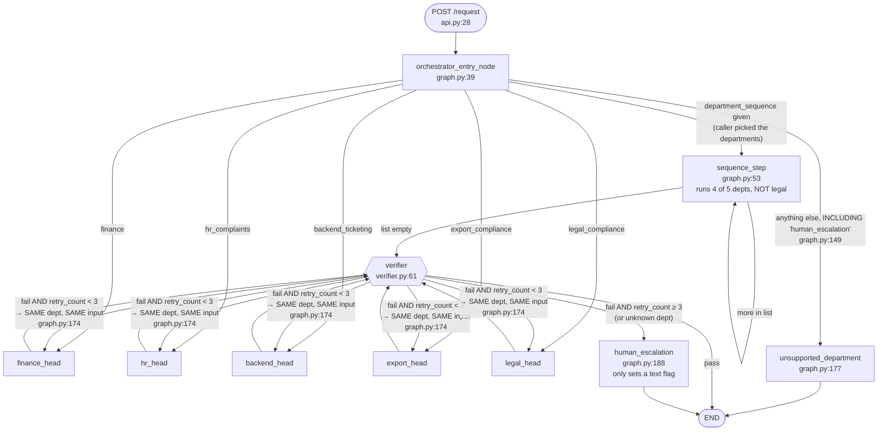

# How Agent Company works today (Phase 0 audit)

> **Status:** this describes `main` **before** the rebuild. Later phases change it; `DECISIONS.md` records each change. It is rewritten at the end (Phase 7).

This document describes the system **as it is on `main` before any change**, written from reading every
file and from a few read-only experiments. Nothing in the code was modified to produce it.
File and line references (`file.py:NN`) point at the pre-rebuild code.

**What I ran, and what I did not.**
Ran (outside the repo, no live services, no keys): the cache similarity probe, the finance validator on the repo's own
sample data, an import of `orchestrator.py` with no API key, a check of what `@mcp.tool()` returns under the pinned
`mcp<2`, and the existing tests that can run offline (results in section 4).
Did **not** run: the full graph or any live department. Every external service (TypeSafe/Jev, Bedrock,
NiryatAI, the Legal RAG server, the HR Ollama server, the ticketing agent) needs a key or a URL I do not have.
Statements about what those services return come from the code and its own docs, and are marked as such.

---

## 1. The graph as it runs today

Reading it in plain words:

1. **Orchestrator** picks one of five departments from the free text (details in 2.0).
2. The **department head** does its work and writes a `department_output`
   (`decision`, `confidence`, `rationale`, `evidence_ids`, `source`).
3. The **verifier** applies a confidence threshold, sometimes asks an LLM, and says pass or fail.
4. On fail it **re-runs the same department with the same input** up to the cap, then ends in the `human_escalation`
   node.

Two things the diagram hides, both important:

- **Most "needs a human" outcomes never touch the human node.** A department that returns
  `decision="human_escalation"` goes verifier → pass (`verifier.py:21`) → END. The `human_escalation` node is only
  reached after the verifier fails three times. So "human review" is mostly just a string in the JSON response.
- **`unsupported_department` skips the verifier** (`graph.py:297`) and the API reports `needs_human: false` for it
  (`api.py:62`), even though nobody handled the request.

Retry count: `MAX_RETRIES = 3` (`graph.py:17`) and the check is `retry_count >= 3` (`graph.py:170`), so a department
actually runs **3 times in total (2 retries)**, not "3 retries".

State: one `GraphState` dict (`state.py:12`) that every node mutates in place and returns.
There is no checkpointer (`graph.py:299`: `graph.compile()` with no arguments), so a run cannot be paused or resumed.

---

## 2. Each department

How to read these: **"confidence"** is the number stored in `department_output.confidence`, and the verifier
treats it as if it meant the same thing everywhere. **"evidence_ids"** is what the verifier checks is non-empty.

### 2.0 Orchestrator (routing, not a department) — `orchestrator.py`

| | |
|---|---|
| Input | `raw_input` only. |
| Branches | (1) **cache hit** on text similarity ≥ 0.90 → reuse the cached department (`:111-115`). (2) **Jev** (TypeSafe `Choice` question over the five departments); if Jev's confidence ≥ 0.75 → that department, and cache it (`:117-122`). (3) otherwise **Claude Haiku via AWS Bedrock** is asked to reply with one department name; a valid name → that department with a fixed 0.85; anything else → `"human_escalation"` (`:85-107`). Budget: 5 LLM calls per request, shared with the verifier (`state.py:47`). (4) A Bedrock error, or budget at 0, → `"human_escalation"`. |
| External services | TypeSafe API (needs `TYPESAFE_API_KEY`); AWS Bedrock `us-east-1` (needs AWS credentials; region and model ID hard-coded, `:92-96`). |
| What "confidence" is | For Jev: whatever TypeSafe reports for its top choice; its calibration is not known to this repo. For the Bedrock fallback: a **hard-coded 0.85** (`:103`). This number is only used inside the orchestrator; it is not passed on. |
| Failure behaviour | `local_classify` is **not** in a try block (`:117`). If TypeSafe is down or the key is missing, the exception propagates and the API answers HTTP 500. Only the Bedrock step is guarded. |

### 2.1 Finance — `finance.py`, `finance_policy.py`

| | |
|---|---|
| Inputs | `department_fields` (a dict) and `sub_department` (`"ar"` or `"ap"`). Both must be supplied by the caller. Nothing derives them from the sentence. |
| Branches | `sub_department == "ar"` → validate a credit record (6 numeric fields, strict types, age/employment consistency, `finance_policy.py:40-51`) → return a fixed "human_review" analysis. `== "ap"` → validate an invoice (10 fields; `overdue` and `is_round_number` must agree with the other fields, `:16-22`) → apply 3 flag rules plus a "30 days past terms" hold rule (`:27-38`) → return approve/flag/hold. Anything else → "Unknown finance capability" (`finance.py:38`). |
| External services | **None.** Pure local rules. (The `.pkl` models in `models/finance/` are never loaded by any code path.) |
| Decision | **Always `human_escalation`**, on every branch (`finance.py:21, 30, 33, 38`), by deliberate "fail-closed" policy. The AP recommendation (approve/flag/hold) appears only inside the rationale text. |
| What "confidence" is | **A constant `0.0`.** It means nothing. (`invoice_policy` returns `confidence: None` inside its `analysis` dict, which is the honest value, but the output's own `confidence` field is set to 0.0 and the `analysis` dict is not what the verifier or the API looks at.) |
| What `evidence_ids` contains | AR: `[]`. AP: `["ap-triage-v2"]`, the **name of the policy version**, not data. It is attached even when the invoice failed validation (`finance.py:30`). |
| Verifier | Passes immediately because the decision is `human_escalation` (`verifier.py:21`). The retry wrapper `finance_node_wrapper` / `llm_escalate_finance` (`graph.py:22-36`, `finance.py:32`) can therefore never run. |
| Note | `api.py` returns only 5 fields of the output, so the `analysis` dict (the actual policy result) is dropped from the response. |

### 2.2 HR / Complaints — `hr_complaints.py`, `hr_agent_mcp.py`

| | |
|---|---|
| Inputs | `department_fields["complaint_text"]` or else `raw_input`. |
| Branches | (1) **cache hit** on `raw_input` similarity ≥ 0.92 → return the cached output (`:44-49`); the cache is keyed on `raw_input` but the text actually used may be `complaint_text`. (2) **Jev "Noul"** question "is this a complaint?" gives a probability *p*. If *p* ≥ 0.5 → `human_escalation` (`:67-77`). (3) Otherwise ask the **HR agent** (`asyncio.run`, `:79`). On error → `human_escalation`. On success → `decision="answered"`. |
| External services | TypeSafe API (the complaint gate); an HR agent HTTP server at `HR_AGENT_QUERY_URL`, default **`http://localhost:8090/query`** (`hr_agent_mcp.py:19-21`). That server is a separate project, not in this repo, that runs Text-to-SQL + RAG on Ollama (`llama3.2`, `embeddinggemma`) on the owner's laptop. Timeout 280 s (`:36`), while the error text says "120s" (`:43`). |
| What "confidence" is | Complaint branch: *p*, the probability the text **is** a complaint. Answered branch: **`1.0 − p`** (`:91`), i.e. how sure Jev is that it is **not** a complaint. It says nothing about whether the SQL answer is right. Error: `0.0`. |
| What `evidence_ids` contains | Complaint: `["jev_complaint_gate"]`. Answered: `["hr_agent_text2sql_rag"]`. Both are **constant labels**. The HR agent's own docstring says it returns `{answer, evidence}`, but the node reads only `answer` (`:92`); the evidence is discarded. |
| Verifier | `answered` with 1−*p* ≥ 0.65 passes by rule with no look at the answer. Only 1−*p* between 0.5 and 0.65 triggers an LLM check. Complaints pass (human_escalation). |

### 2.3 Backend / Ticketing — `backend_ticketing.py`, `ticketing_mcp.py`

| | |
|---|---|
| Inputs | `raw_input` only. (`department_fields` is ignored.) |
| Branches | Local checks first, in this order: invalid input (empty, > 8000 chars, NUL) or **prompt-injection regex** → `human_escalation` (`:32-38`). **Security-keyword regex** (malware, phishing, breach, "suspicious ", …) → `human_escalation` to the Security Team (`:39-45`). Otherwise PII-scrubbed text is POSTed to the ticketing agent (`:47`). Agent unreachable → `human_escalation`. Agent says `needs_human` → `human_escalation`. Otherwise → `decision="answered"` with the agent's answer. |
| External services | A deployed ticketing agent at `TICKETING_URL`. The **default is a CloudFront URL that the code's own comment says is dead** (the EC2 box behind it was terminated, `ticketing_mcp.py:16-21`). 30 s timeout. |
| What "confidence" is | Answered: **a hard-coded `1.0`** (`:72`). Escalated by the agent: whatever `confidence` the remote agent returns, or `0.0` (`:61`); its meaning is unknown to this repo. Local-regex escalations: `0.0`. |
| What `evidence_ids` contains | Answered: `["ticketing_agent:<category>"]`, a label made from the agent's own category. Escalated: `[]`. The agent's reasoning or sources are not carried. |
| Verifier | An answered ticket has confidence 1.0 and one label, so it **always passes by rule; the answer is never examined.** |
| Note | The raw agent JSON is stored in `state["backend_triage"]` and returned to the API caller verbatim (`:79`, `api.py:60`). The previous local DistilBERT path (`backend_model.py`) is no longer called by anything. |

### 2.4 Export / Compliance — `export_compliance.py`, `niryat_mcp.py`

| | |
|---|---|
| Inputs | `department_fields["product_description"]` or else `raw_input`. The whole text is wrapped as *"What is the HS code for {text}?"* (`:33-37`), so a full question becomes "What is the HS code for What HS code applies to…". |
| Branches | (1) Ask NiryatAI `/chat` (streamed, an LLM's prose). Error → `human_escalation`. (2) A regex looks for a 6–8 digit code in the prose; none found → `human_escalation` (`:54-64`). (3) Look the code up in `/tradedata` (a live scrape of India's TradeStat site). Lookup **errors** → decision = the HS code, confidence **0.5** (`:69-81`). Record **found** → decision = the HS code, confidence **0.85** (`:83-108`). Record **not found** → decision = the HS code, confidence **0.4** (`:110-121`). |
| External services | NiryatAI on Railway (public URL hard-coded, `niryat_mcp.py:27-28`): `/chat` 60 s, `/tradedata` 90 s. No cache by design. |
| What "confidence" is | **Three hand-picked constants** (0.85 / 0.5 / 0.4). The code's own comment admits 0.85 is "HIGH for this department, not equivalent to a trained model's probability" (`:91-93`). |
| What `evidence_ids` contains | `["niryat_chat_proposal"]` or `["niryat_chat_proposal", "tradestat_verified_<code>"]`: labels. The text is in the rationale (the LLM's full answer, the first TradeStat commodity name, and a market signal). |
| How strong the "verification" really is | "found" means **a TradeStat record exists for that code**. Nothing compares the record's commodity name with the product the user asked about; the name is only printed (`:84-85`). A wrong-but-valid code would still score 0.85. |
| Verifier | 0.85 → pass by rule. 0.5 → ambiguous → LLM (Bedrock). **0.4 → rule fail → retry the identical export call twice more → human_escalation node.** Each attempt can take up to ~150 s. |

### 2.5 Legal / Compliance — `legal_compliance.py`, `legal_rag_mcp.py`

| | |
|---|---|
| Inputs | `department_fields["question"]` (else `raw_input`) and optional `act_filter` (BNS, BNSS, BSA, DPDP, ALL). |
| Branches | Call the Legal RAG server. Error → `human_escalation`. No citations → `human_escalation`. Otherwise `decision` = the first `[Act, Section N]` pattern found **in the generated answer text**, or, if the answer has none, the top retrieved section with a warning appended (`:79-103`). |
| External services | A Legal RAG FastAPI server at `LEGAL_QUERY_URL`, default **`http://localhost:8000/query`** (`legal_rag_mcp.py:11`); a separate project (BERT retrieval + an LLM, Redis, a prebuilt index). 60 s timeout. |
| What "confidence" is | The **retrieval similarity score of the first citation** (`:80, 108`): a measure of how close the question text is to a statute passage. It is not the probability that the generated answer is correct. Typical observed value 0.64 (per `docs/MCP_SERVERS.md`), which falls in the verifier's "ambiguous" 0.5–0.65 band. |
| What `evidence_ids` contains | `["legal_section_357", …]`, one label per retrieved section: **section numbers only**, not the section text. The decision (section cited in the answer) and the evidence (sections retrieved) are never compared. |
| Verifier | Scores in 0.5–0.65 go to the Bedrock check, which sees the answer text and the section-number labels but no statute text. With no Bedrock access the check returns "fail" (`verifier.py:56-58`), so every such answer is retried twice and then escalated. |
| Note | In a package import (`from .x import`), the fallback branch imports `from state import …` without the dot (`legal_compliance.py:10`). |

### 2.6 The verifier — `verifier.py`

1. Rule check (`:20-29`): `human_escalation` → pass; no `evidence_ids` → fail; confidence < 0.5 → fail;
   0.5 ≤ confidence < 0.65 → "ambiguous"; otherwise pass.
2. Ambiguous → ask Claude Haiku "PASS or FAIL" given **decision, confidence, rationale, evidence_ids** and
   the instruction to check only "internal consistency" (`:14-17, 36-41`). No budget or any error → fail.
3. Pass → write the output into the department cache if one is registered (HR only is live, `:80-83`).
   Fail → `retry_count += 1`.

---

## 3. Defects

Verdict key: **CONFIRMED** = I verified it in code and, where noted, by running something.
Items 1–11 are your list; 12–23 are additional things I found.

### Your 11 claims

| # | Claim | Verdict | Evidence |
|---|---|---|---|
| 1 | Confidence means something different per department but one threshold is applied | **CONFIRMED** | Finance constant 0.0 (`finance.py:21,30,33,38`). HR = 1 − P(complaint) (`hr_complaints.py:91`). Backend answered = constant 1.0 (`backend_ticketing.py:72`). Export = constants 0.85/0.5/0.4 (`export_compliance.py:73,97,113`). Legal = top retrieval similarity (`legal_compliance.py:108`). One rule for all: `<0.5` fail, `0.5–0.65` LLM, else pass (`verifier.py:25-29`). Consequences: Backend can never be questioned; Export's 0.4 always hard-fails and 0.5 always calls an LLM; Legal's ~0.64 always calls an LLM. |
| 2 | Verifier never sees source evidence, only labels and the department's own rationale | **CONFIRMED** | `verifier.py:36-41` sends decision, confidence, rationale and `evidence_ids`. The ids are labels (see each table above). The prompt tells the model to check "internal consistency" only (`:14-17`). The retrieved statute text, TradeStat record, SQL rows and the ticket agent's sources never leave the department. Also, only the 0.5–0.65 band reaches an LLM at all. |
| 3 | A verifier fail re-runs the same department with the same input | **CONFIRMED** | `graph.py:163-174` routes back to the same head. The verifier returns only pass/fail (`verifier.py:54-55`), so no feedback exists to pass on, and state carries none. For external-service departments this repeats the same remote call (Export up to ~150 s each). The one department with a different retry (`finance_node_wrapper`) is unreachable (2.1). |
| 4 | `cache.py` matches on string similarity, so different questions collide | **CONFIRMED (run)** | `cache.py:14` uses `difflib.SequenceMatcher`. Probe results at threshold 0.92 (HR) / 0.90 (orchestrator): *"…in the Sales department?"* vs *"…in the **Legal** department?"* = **0.936 → HIT**; vs *"…IT department?"* = 0.923 → HIT; *"Section 357 of BNS"* vs *"Section 358"* = 0.970 → HIT; *"invoice INV-4021"* vs *"INV-4022"* = 0.960 → HIT. A cached Sales answer ("1035") was returned for the Legal question. This is the bug in `evals/evals.md`. Also: in-memory dict, no TTL, no size limit, no lock (`api.py:50` runs requests in threads), full scan per lookup, and answers about live data are cached forever (`verifier.py:80-83`). |
| 5 | Orchestrator `"human_escalation"` falls into `unsupported_department` | **CONFIRMED, and worse** | `orchestrator.py:104,107` returns the string as a "department"; `graph.py:149` has no case for it, so it reaches `unsupported_department` (`:177-185`), which skips the verifier and the human node. `api.py:62` then reports `needs_human: false`: an unclassifiable request is reported as not needing a human. |
| 6 | Human escalation is a flag with no pause and resume | **CONFIRMED** | `human_escalation_node` only writes `escalation_reason` (`graph.py:188-197`). No checkpointer (`:299`), no `interrupt()`, no endpoint to list or resume (`api.py` has only `/request` and `/health`). Departments that escalate themselves never reach the node at all. |
| 7 | The `*_mcp.py` servers are not used in the request path | **CONFIRMED** | Departments do `from xxx_mcp import ask_…` and call the function directly (`hr_complaints.py:17,79`, `backend_ticketing.py:16,47`, `legal_compliance.py:8,44`, `export_compliance.py:7,33,67`). No MCP client exists anywhere (searched for `ClientSession`, `stdio_client`, `sse_client`: none). With the pinned `mcp<2`, I confirmed `@mcp.tool()` leaves the plain async function untouched. The MCP servers are never started. They are `httpx` wrappers used as a library. `ticket_router_mcp.py` is imported by nothing (and hard-codes a plain-HTTP raw IP, `:14`). `docs/MCP_SERVERS.md` presents all of this as MCP. |
| 8 | Finance cannot work from free text because nothing extracts fields | **CONFIRMED** | A free-text request gives `department_fields={}` and `sub_department=None` (`api.py:40-45`) → "Unknown finance capability" (`finance.py:38`). No code anywhere parses text into fields. The UI's follow-up form is dead: `isFinanceNeedsFieldsError` always returns false (`frontend/lib/api.ts:53-55`) and `route.ts:193` forwards only `request_id` and `raw_input` to Python, dropping the fields that `AskConsole.tsx:50-61` sends. Even with fields, finance always escalates by design. And the repo's own AP "anomaly" sample (invoice 380000, `is_round_number: False`) **fails the validator** because 380000 is a multiple of 10000. `test_finance.py` prints "Invoice fields failed validation" for it and still exits 0. |
| 9 | HR depends on a localhost service; README describes a backend model path the code no longer uses | **CONFIRMED** | HR: `http://localhost:8090/query` backed by Ollama on the owner's laptop (2.2; `README.md:40`; `/Users/apple/...` paths). README lines 3–26 describe a local DistilBERT backend via `backend_model.py`. `backend_ticketing.py` calls the remote ticketing agent instead; `backend_model.py` has no importer. Its default URL is documented as dead (`ticketing_mcp.py:16-18`). `complaint_agent.py` (torch/CrewAI, hard-coded `/Users/apple/...` model paths, default API key string `'your_key_here'`, lines 7-19) is also dead; `requirements.txt` says it is retired but the file and `test_hr.py` still reference it. |
| 10 | Tests need live API keys at import time | **CONFIRMED (run)** | `orchestrator.py:23` and `hr_complaints.py:24` call `TypeSafeClient()` at import. With `TYPESAFE_API_KEY` unset, `import orchestrator` raises `TypeSafeError: No API key was provided`. `api.py:14` builds the whole graph at import. `test_graph`, `test_sequential`, `test_cap_logic`, `test_hr` all die at import for this reason (section 4). |
| 11 | `frontend/lib/orchestrator.ts` duplicates the Python router | **CONFIRMED, and it is more than a router** | `orchestrator.ts:21-47` copies `_DEPARTMENT_CRITERIA`; `:86-95` copies the backend regexes. It **behaves differently**: no 0.75 threshold and no LLM fallback, and `null` becomes `backend_ticketing` (`route.ts:217`). `route.ts` is a complete second backend: an in-process TF-IDF ticket model (`helpdeskModel.ts`), canned "human_escalation" replies for the other four departments (`:139-164`), and a **silent fallback** to all of that whenever the Python API errors or is slow (`:186-212`). The UI can therefore show an answer from a different system without saying so. |

### Additional defects

| # | Defect | Where |
|---|---|---|
| 12 | **Every node mutates state in place** and returns it (including `log_audit`, popping the sequence list, and decrementing the LLM budget). It works today by accident; it will break checkpoint/resume. | `state.py:62-70`, `graph.py:29,58`, `orchestrator.py:94`, `verifier.py:47`, all heads |
| 13 | **External failures can crash the request.** Jev (orchestrator and HR gate) is unguarded; any exception becomes HTTP 500. | `orchestrator.py:117`, `hr_complaints.py:51` |
| 14 | **The 500 handler leaks exception text** (`str(e)`) to the caller; **no authentication**; no CORS; client-chosen `request_id`. | `api.py:64-68` |
| 15 | **No end-to-end time limit.** HR waits up to 280 s, Export up to ~150 s per attempt, and the verifier can repeat an attempt twice. A hung dependency holds a worker thread. | `hr_agent_mcp.py:36`, `niryat_mcp.py:68,115`, `graph.py:170` |
| 16 | **Without AWS Bedrock access, ambiguous results always fail**, then loop and escalate, so e.g. most Legal answers (score ≈0.64) end as human review regardless of quality. | `verifier.py:33-34,56-58` |
| 17 | **Types lie.** `DepartmentOutput.source` is `Literal["cache","local_model","llm"]` but nodes emit `"human_escalation"` (suppressed with `# type: ignore`). | `state.py:9`, many heads |
| 18 | **Sequential mode** supports only four departments (legal returns "unsupported"), takes department choice from the caller (contradicting free-text routing), and verifies only the last step. | `graph.py:108-115, 123-133` |
| 19 | **The frontend "advanced" view lets the user pick the department** (scenario tabs). | `frontend/app/page.tsx:14,46-68` |
| 20 | **Dead or stale code and docs:** `complaint_agent.py`, `backend_model.py`, `ticket_router_mcp.py`, `llm_escalate_finance`, the `.pkl` models (pickles run code on load; nothing loads them), unused runtime requirements (xgboost, scikit-learn, pandas, faker), `MODEL_BASE_PATH` in the Dockerfile, `docs/ROUTING_REGRESSION.md` (describes a keyword router that no longer exists), `frontend/README.md` (describes a demo mode and `NEXT_PUBLIC_API_BASE_URL` that the code does not have; real variable is `AGENT_COMPANY_API_URL`), `frontend/lib/types.ts` and `BackendTriage.tsx` (describe DistilBERT). |
| 21 | **Three different "backend" implementations** exist: remote ticketing agent (Python), DistilBERT (dead), TF-IDF (frontend). Documentation describes the second, the frontend runs the third. | `backend_ticketing.py`, `backend_model.py`, `frontend/lib/helpdeskModel.ts` |
| 22 | **Machine- and person-specific values committed:** `/Users/apple/...` paths, a public ngrok tunnel URL (`docs/MCP_SERVERS.md:226`), a raw-IP HTTP endpoint (`ticket_router_mcp.py:14`). I found **no key-shaped secrets** in a pattern scan; `complaint_agent.py` and `frontend/.env.local.example` contain only placeholders. | listed |
| 23 | **Test suite is not a test suite:** scripts with module-level code and `print`, not pytest; several assert behaviour that no longer exists; `test_finance.py` exits 0 while printing validation failures. | section 4 |

---

## 4. State of the existing tests (run today, no keys, no services)

Run with the dependencies pinned in `requirements.txt` in a throw-away venv. `TYPESAFE_API_KEY` and
`ANTHROPIC_API_KEY` unset.

| Test file | Result | Why |
|---|---|---|
| `test_finance.py` | exit 0 | Prints only. It does not assert, and one of its own cases prints a validation failure. |
| `test_extraction_fix.py` | **pass** | Pure regex test on two captured strings. |
| `test_legal.py` | exit 0 | Script. The fallback unit test runs; the live cases just print "unreachable". |
| `test_verifier.py` | **fail** | `AssertionError` at line 67: expects Finance to emit a confidence in 0.5–0.65, but Finance now emits 0.0. Stale. |
| `test_cap_logic.py` | **error** | Dies at import: no `TYPESAFE_API_KEY`. (Its logic is pure and would not need the key.) |
| `test_graph.py`, `test_sequential.py` | **error** | Same import-time key failure. |
| `test_hr.py` | **error** | Same, and it tests a retired path (`hr_complaints.analyze_reviews`, decision `not_a_complaint`, neither exists). |
| `test_backend_model.py` | **fail** (1 failure, 7 errors of 8) | Tests the old DistilBERT backend, which needs a sibling project directory that is not in this repo. |
| `test_export.py` | not run | Live: needs the NiryatAI network service. |

Frontend: the five Playwright specs call a real running backend and are not runnable offline. I did not run them.

---

## 5. Things I could not verify

- Anything about the live services' real behaviour (Jev's score calibration, NiryatAI answers, the Legal RAG
  similarity range, HR agent output, whether the CloudFront ticketing URL is really dead). I relied on the
  repo's own comments and docs for those and said so above.
- The shape of the HR agent's `evidence` field (read from a docstring only).
- The full graph run end to end.
