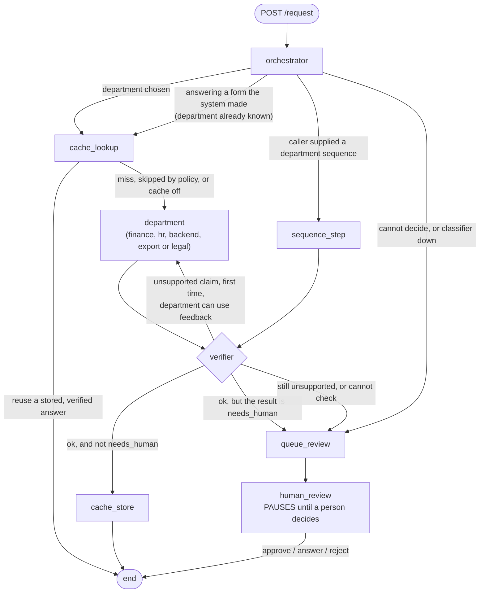

# How Agent Company works

This is the explanation of the system **as rebuilt**. It began as a Phase 0 audit of the original code; that audit's
list of defects is kept in section 5, each marked with what happened to it. Wherever this document says something
has been verified, it says how. Where it says nothing about a live service, assume it has not been run against one.

## 1. The one-minute version (for explaining it to someone)

A person types one sentence. A **router** picks one of five departments. The department does its work and returns a
result in one fixed shape, with the **evidence it relied on**. A **verifier** then checks that every claim in the answer is
supported by that evidence. If something is unsupported it gets **one** retry, with the specific complaint as feedback. If it still
fails, or nobody can check it, or the department says a person must decide, the run **pauses** and goes into a review queue until
a person approves, rewrites or rejects it. If details are missing, the person is shown a **form** for exactly those. If a service
is down the result is a plain `failed` that says which one.

Four rules hold everywhere: **no invented numbers** (a confidence is only shown if a department really has one, and is labelled
with what it is), **no label standing in for evidence** (evidence is text or data), **nothing is called "verified" unless it was**, and
**no internal error text ever reaches a caller**.

## 2. The graph

What each step is, in `graph.py` and the files it calls:

- **orchestrator** (`orchestrator.py`): asks TypeSafe's Jev model which department; if it is not confident (below
  `ROUTER_MIN_CONFIDENCE`, default 0.75) or fails, asks Claude Haiku on Bedrock. If neither can decide it says so, with a reason that tells
  *unsure* (`request_not_classified`) from *unreachable* (`classifier_unavailable`). A request answering a form the system itself
  generated skips routing: the form says which department it came from.
- **cache_lookup / cache_store** (`cache.py`): reuse of a verified answer. Off unless an embedding provider is configured. Only Legal may
  ever be cached (section 4.4).
- **department** (`departments.py`): runs one department with a hard deadline; a hung or crashing department becomes `failed`.
- **verifier** (`verifier.py`): section 4.3.
- **queue_review / human_review** (`graph.py`, `review.py`, `review_store.py`): section 4.5.

An API client may instead supply a `department_sequence` (run several departments in order). The console never does, and only the last
step is verified. Authentication is the guard for that option.

## 3. The result every department returns

`contract.py` defines `DepartmentResult`. The model **enforces** its own rules, so a department cannot get them wrong silently:

| Field | Rule |
|---|---|
| `status` | `answered`, `needs_human`, `needs_more_info` or `failed` |
| `answer`, `evidence[]` | `answered` needs both. Each evidence item must carry real text or data, never just a label. |
| `reason` | `needs_human` needs a short code a person can act on (for example `security_incident_review`). |
| `missing_fields`, `follow_up` | `needs_more_info` needs the field names; `follow_up` describes the form (labels, kinds, per-field problems). |
| `error` | `failed` needs it, and it is always a short safe code such as `legal_rag: unreachable (ConnectError)`. |
| `confidence` | `{kind, value}`. Kinds: `calibrated_probability`, `retrieval_score`, `none`. `none` must have no number. Only Legal reports one (`retrieval_score`). |

Next to the result the API returns `verification` (`verified`, `unchecked`, `human_approved`, `human_provided`, ...), `pending_review`, and the
full `audit_trail`.

## 4. How the pieces work

### 4.1 The departments

| | Input | Branches | Service | Evidence | Verification |
|---|---|---|---|---|---|
| **Finance** | The sentence, plus a form | Path unknown: ask. AR or AP: fill the record from the form, from numbers the model read **and the code verified**, and from derived values; ask for what is missing or wrong; otherwise apply the policy. A valid request always ends `needs_human` with the recommendation. | None. A model reads the sentence. | The validated record, the policy outcome, and where each value came from | Rule-based: never sent to a model |
| **HR** | The sentence | A complaint (Jev gate) goes to a person and the agent is never called. Otherwise ask the HR agent. No evidence returned: held for a person. | HR agent | What the agent returns | Claims checked, one retry |
| **Backend** | The sentence | Local screens first: invalid input, prompt injection, security keywords. Otherwise (PII scrubbed) the ticketing agent. | Ticketing agent | Its classification only | **None possible**: labelled `unchecked` |
| **Export** | The sentence | Ask NiryatAI for an HS code; no code: a person. Look it up in TradeStat. Found: answer. Not found or lookup down: a person, with the proposal attached. | NiryatAI chat + TradeStat lookup | The proposal and the TradeStat record | Claims checked, including that the record matches your product; one retry |
| **Legal** | The sentence | Ask the Legal RAG service. No relevant sections: a person. | Legal RAG | Each retrieved section's title and summary | Claims checked, one retry |

### 4.2 Reading numbers from a sentence (Finance)

A model proposes values and **a verbatim quote** for each. The code accepts a value only if the quote is really in your sentence and, for a number,
the number really is in that quote (`65,000`, `₹65000`, `1.5 lakh` all work; a made-up 70000 does not). Anything else is treated as "not stated"
and asked on the form. **Yes/no facts are never read from prose**: "not a first-time vendor" misread would silently change the policy result, so they
always come from the form. If the model is unreachable you get a form for everything, not an error. The form is described by the backend (`follow_up`),
and the console only renders it.

### 4.3 The verifier

For an `answered` HR, Export or Legal result, a model lists the factual claims in the answer and judges each against the evidence text **only**. A
"supported" verdict must quote the evidence, and the code confirms the quote is really there, otherwise the verdict is downgraded. Any unsupported or
contradicted claim fails the answer: one retry with those claims as feedback, then the answer is **withdrawn** to `needs_human`, keeping the draft
and the findings for the reviewer. It is never released as `answered`. If the checker itself is unavailable the answer is withheld by default.

Not sent to a model: results that are not `answered`; Finance (rule-based); Backend (no sources). Those pass as `unchecked` and are labelled so.

### 4.4 The answer cache

Reuse needs **all** of: a department that may be cached (only Legal, whose answers come from a fixed statute corpus), no personal identifiers or first-person
wording, the same scope, **identical numbers, acronyms and capitalised names** (so "Section 357" can never answer "Section 358", which embeddings alone would
allow), an unexpired entry, and embedding similarity at or above a threshold. Only verified `answered` results are stored. Finance, HR, Backend and Export are never
cached (a person's data, live data, a specific ticket, a live check).

### 4.5 Waiting for a person

Anything that must not be decided by a machine goes to `queue_review`, which files it in a review inbox, then `human_review` **pauses the run** (LangGraph
`interrupt()`) with its state saved in SQLite or Postgres. It survives restarts. A reviewer with a `reviewer` API key sees `GET /reviews` and decides with
`POST /reviews/{id}/resume`: **approve** the draft, **answer** themselves, or **reject** with a note. The reviewer recorded is the name of the key, never something the
caller types. Two simultaneous decisions cannot both win. A person's decision is labelled as theirs and is never cached. The person who asked gets a reference and can check
for the decision.

### 4.6 Failure, timeouts and secrets

Every service address and timeout comes from the environment; an unset address is `failed: not_configured`. Every department attempt has a hard deadline.
A failed call is reduced to a safe code; exception text and remote response bodies go to the server log only. A 500 returns an incident id. `/ready` reports
storage, auth and each department's service.

## 5. The original 11 claims, and what happened

| # | Original defect | What happened |
|---|---|---|
| 1 | Confidence meant something different per department, one threshold applied | Every hard-coded number removed. Confidence is `{kind, value}`; only Legal has a number, labelled `retrieval_score`. The verifier no longer thresholds anything. (D-007, D-009) |
| 2 | The verifier never saw source evidence | It now checks each claim against the evidence text, and its own verdicts must quote that text. (D-033) |
| 3 | A verifier fail re-ran the same department with the same input | One retry, only with specific feedback, passed to the department. Failed results are never retried. (D-035) |
| 4 | The cache matched on string similarity, so different questions collided | Replaced by an embedding cache with policy, discriminators, TTL, and verified-only storage; I showed the old collision (0.936) and that embeddings alone would repeat it. Off until a provider is set. (D-021) |
| 5 | `human_escalation` fell into `unsupported_department` | Routed explicitly to the review queue, with a reason that separates "unsure" from "unreachable". (D-019, D-020) |
| 6 | Human escalation was a flag with no pause and resume | A real checkpointer, `interrupt()`, a review inbox, and endpoints to list and resume; tested across a real process restart, on SQLite and a real Postgres. (D-041 to D-046) |
| 7 | The `*_mcp.py` servers were not in the request path | Confirmed they were plain functions. **Renamed to plain HTTP clients and the MCP claim removed, by my default because you did not choose** (one commit, easy to revert). (D-049) |
| 8 | Finance could not work from free text | Path and numbers are read from the sentence (verified), a backend-described form asks for the rest. Only what the policy uses is asked. (D-026 to D-032) |
| 9 | HR needed a localhost service; the README described a path the code no longer used | HR is now an address from the environment (you moved it to Haiku). The dead DistilBERT path is deleted and the README rewritten. (D-050, D-057) |
| 10 | Tests needed live API keys at import | Clients are created on first use. 433 tests run with no keys and every service mocked, on Python 3.11 and 3.13. |
| 11 | `frontend/lib/orchestrator.ts` duplicated the Python router | Deleted, with the in-process fallback model and the canned replies. The console only forwards your sentence to the Python API. (D-023) |

## 6. The other defects found in the audit

| # | Defect | What happened |
|---|---|---|
| 12 | Every node mutated state in place | Nodes return partial updates with append reducers; a test checks no node mutates its input. (D-006) |
| 13 | A router outage crashed the request | Routing failure goes to a person with a clear reason. (D-018, D-019) |
| 14 | 500s leaked exception text; no authentication | Incident ids; API keys with client and reviewer roles; fail closed. (D-054, D-055) |
| 15 | No end-to-end time limit | Per-call timeouts and a per-department deadline. (D-050, D-052) |
| 16 | Without Bedrock, ambiguous results looped and escalated | Replaced by an explicit policy: withheld by default, `VERIFIER_ON_UNAVAILABLE` to choose otherwise. (D-037) |
| 17 | Types did not match the data | One validated contract. |
| 18 | Sequential mode: four departments, caller-picked | Legal is included; still caller-chosen and only the last step is verified. Not changed on purpose. (D-040) |
| 19 | The UI let you pick a department | One text box. A browser test checks there is no way to pick. (D-024) |
| 20 | Dead code and stale docs | Deleted: `complaint_agent.py`, `backend_model.py`, the old root test scripts, the stale routing doc, the demo page and old eval reports. The `models/` pickles were deleted afterwards (D-063). The training scripts and synthetic data remain. (Section 7) |
| 21 | Three different "backend" implementations | One. |
| 22 | Machine-specific values committed | Local paths, a raw-IP endpoint, a tunnel URL and a dead CloudFront default removed. `.env.example` shows the public NiryatAI address as an example only. |
| 23 | The "test suite" was scripts | A pytest suite, a CI workflow, and a live eval you run yourself. |

## 7. What is still not true, or not verified

- **Nothing has run against your real services.** Not the Legal RAG, the HR agent, NiryatAI, the ticketing agent, TypeSafe, nor Bedrock. The tests mock all of them. The live eval (`evals/`) is how you
  find out, and no eval has been run.
- **The prompts for extraction and verification** follow the vendor's tool-use format and are tested against fakes. Whether the models judge claims well is untested.
- **Legal answers will often go to a person at first**, because the service returns summaries rather than passage text (D-039).
- **The HR agent's reply shape is assumed**; Backend returns no sources.
- **The Docker image has never been built** by me (no daemon here). CI builds and starts it.
- **The cache threshold (0.95) is a placeholder** until measured.
- **The finance model pickles were deleted** after the merge (D-063). `train_ap_classifier.py` regenerates the AP ones; the two `credit_risk_*` files had no training script here and exist only in git history. The training scripts and synthetic data remain, unused by the running system.
- **No rate limiting, no stored-run cleanup, no reviewer screen**, and the database holds sensitive data at rest.
